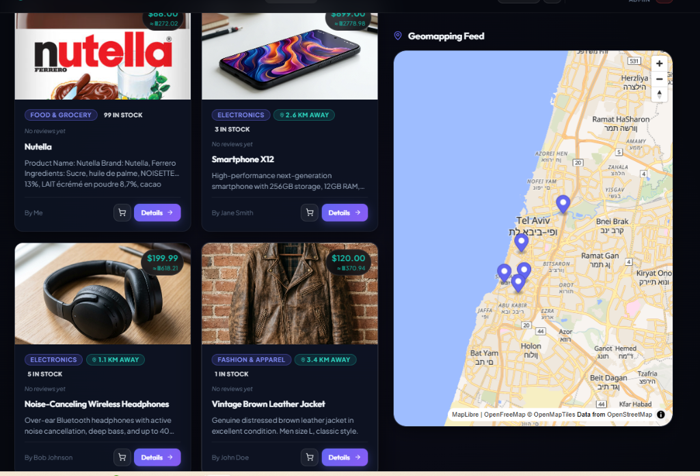
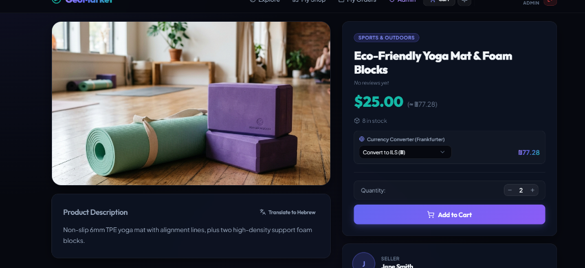
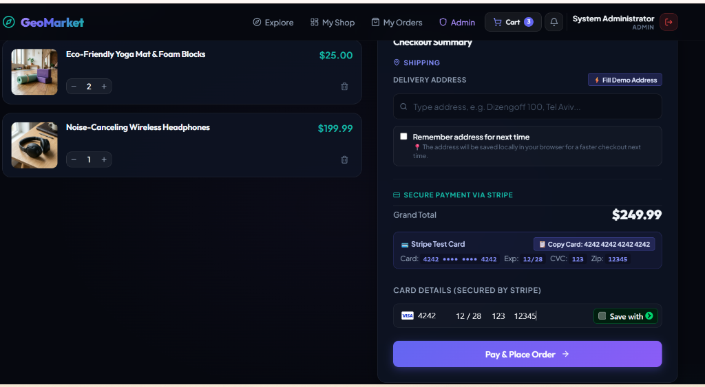
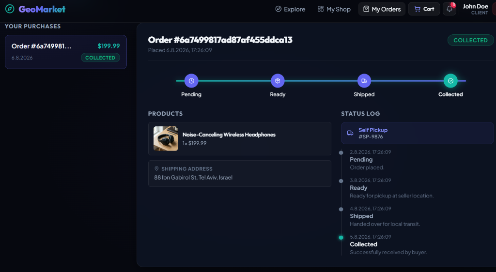
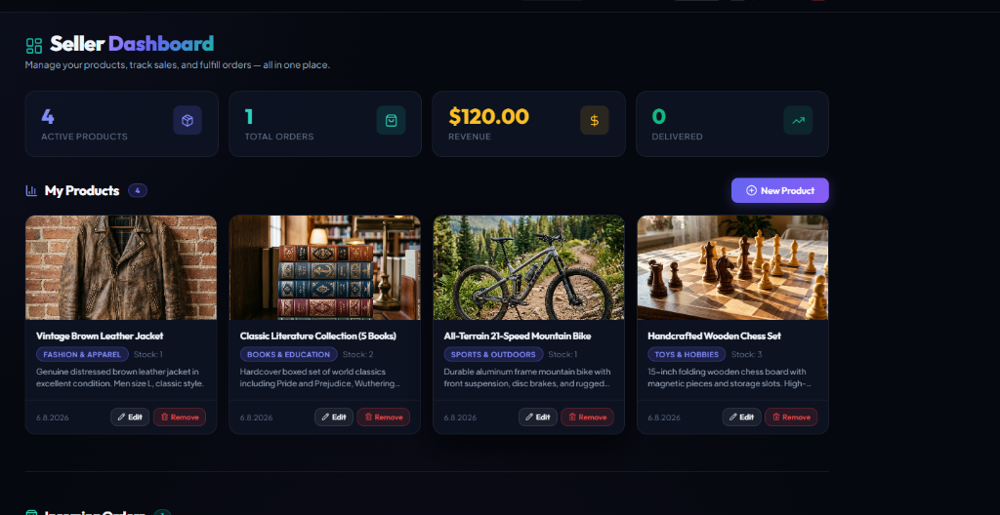
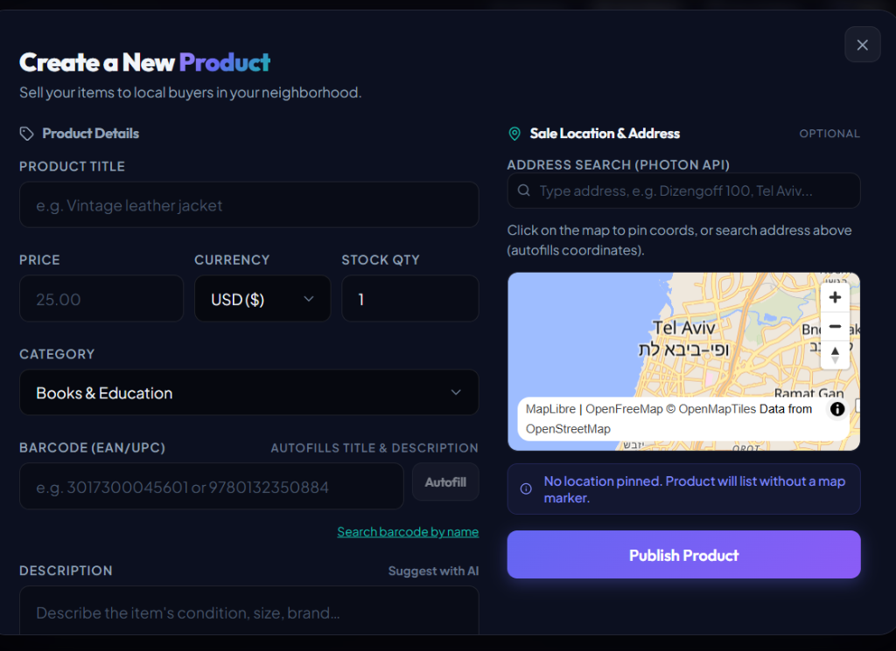
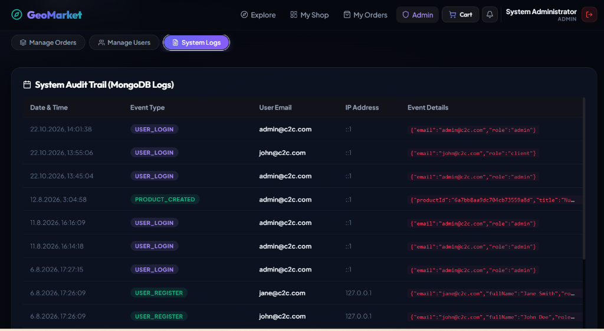
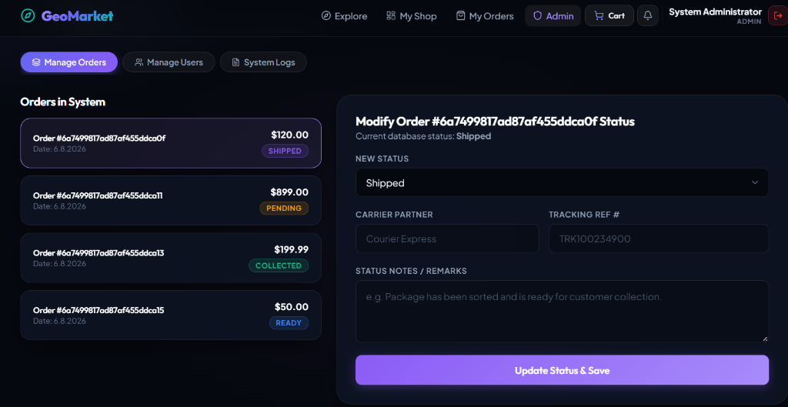

# C2C E-commerce Geo-Marketplace 🌍🛒

A full-stack, Consumer-to-Consumer (C2C) neighborhood marketplace web application. Users can explore items on an interactive map, list products with geographic coordinates, calculate driving distances, convert foreign currencies, and track live order delivery transitions in real-time via WebSockets.

---

> [!IMPORTANT]
> ### 🔑 Quick Demo Credentials (Instant Access)
>
> | Role | Email | Password | Features / Privileges |
> | :--- | :--- | :--- | :--- |
> | **Client (Buyer/Seller)** | `john@c2c.com` | `Client123!` | Browse map, add to cart, checkout with Stripe test card, track order live, publish & manage listings |
> | **System Administrator** | `admin@c2c.com` | `Admin123!` | Access Admin Dashboard, inspect MongoDB event audit logs, update live order statuses, manage users |
> | **Alternative Client** | `jane@c2c.com` | `Client123!` | Additional peer account to simulate buyer/seller transactions |
>
> *Tip: On the [Login Page](http://localhost:5173/login), you can click on the demo account cards to **auto-fill credentials in 1 click**.*

---

## 📸 Visual Showcase & Previews

### 🗺️ Live Geo-Marketplace & Interactive Map
*Interactive neighborhood map powered by MapLibre GL & OpenFreeMap with real-time distance calculations and local currency conversions.*


### 🔍 Product Details, Dynamic Currency & Translation
*Detailed listing page displaying live Frankfurter currency conversions to ILS and on-demand English-to-Hebrew translation via MyMemory API.*


### 💳 Frictionless Checkout & Stripe Sandbox Payment
*Checkout page featuring Photon address auto-completion, one-click demo address fill, and integrated Stripe test card helper.*


### 🚚 Real-Time Order Tracking Timeline (Socket.io)
*Live buyer delivery tracking with state transition progress and chronological status log backed by WebSockets.*


### 💼 Seller Hub & Performance Metrics
*Seller overview showing active items, order volume, revenue analytics, and item management actions.*


### ➕ Geo-Listing Creation with Barcode, AI & Pin-Drop
*Seller modal with interactive MapLibre location pinning, barcode catalog autofill, and AI-suggested product descriptions.*


### 🛡️ System Administration & Dual-Database Audit Trail
*Administrative security portal displaying real-time system audit logs stored in MongoDB.*


### 📦 Admin Order Dispatch & Status Management
*Admin control center for managing order fulfillment and broadcasting live status updates to buyers.*


---

## ✨ Key Features

- **Guest Discovery & Browsing**: Visitors can explore the marketplace, filter categories, search items, inspect pins on the map, and view reviews prior to registration.
- **Smart Auth Redirection**: Protected actions (adding to cart, checkout, managing products) redirect guests to sign in and seamlessly return them back to their current page upon authentication.
- **Hybrid Database Architecture**:
  - **MySQL (Sequelize ORM)**: Relational integrity for Users, Roles, Categories, Products, and Orders.
  - **MongoDB (Mongoose ODM)**: High-write timeline tracking events, live notification logs, and system audit trails.
- **Real-Time WebSockets**: Powered by Socket.io for instant order status state changes broadcasted live to buyers and sellers.
- **Geomapping & Route Calculation**:
  - Interactive maps powered by **OpenFreeMap / MapLibre GL**.
  - Driving distance & estimated duration between buyer GPS and seller location via **OSRM**, with instant Haversine math fallback.
- **Stripe Sandbox Checkout**: Full end-to-end payment processing with one-click test card helpers and address auto-completion.
- **Live Weather Alerts**: Dynamic pickup recommendations (rain, snow, storm warnings) based on item coordinates from **Open-Meteo**.
- **Real-Time Currency Conversion**: Instant price conversions to local currency (ILS) via **Frankfurter API**.
- **Instant Translation**: English-to-Hebrew description translation powered by **MyMemory API**.

---

## 🛠️ Tech Stack

- **Frontend**: React.js (Vite), MapLibre GL (OpenFreeMap), Lucide Icons, Vanilla CSS (Glassmorphism layout design).
- **Backend**: Node.js, Express.js (MVC architecture), Sequelize ORM, Mongoose ODM, Socket.io, Multer, JWT, bcryptjs, Stripe SDK.
- **Databases**:
  - **MySQL**: Relational data (Port `3306`)
  - **MongoDB**: Audit logs and live event tracking (Port `27017`)

---

## 📋 Prerequisites

Ensure you have the following installed locally:
- **Node.js** (v18.0.0 or higher) and **npm**
- **MySQL Server** (listening on port `3306`)
- **MongoDB Server** (listening on port `27017`)

---

## 🚀 Getting Started

### 1. Database Setup
Ensure MySQL and MongoDB services are active.
*The backend application automatically creates the database `c2c_marketplace` if it does not exist, syncs all schemas, and seeds initial categories and test accounts on first run.*

### 2. Environment Configuration
Verify environment files exist in the server and client directories:
- **Backend**: `server/.env`
- **Frontend**: `client/.env`

---

## 🏃‍♂️ Running the Application

Open two terminal windows:

### Terminal A: Backend Server
```bash
cd server
npm install
npm run seed     # Seeds roles, categories, and demo accounts
npm run dev      # Starts Express API at http://localhost:5000
```

### Terminal B: Frontend Client
```bash
cd client
npm install
npm run dev      # Launches Vite dev server at http://localhost:5173
```

Visit **`http://localhost:5173`** in your browser.

---

## 🔌 External API Integrations (Zero Configuration Required)

All third-party services are integrated without requiring personal API keys for effortless evaluation:

1. **OpenFreeMap & MapLibre GL**: Open-source vector tile map rendering.
2. **Photon Geocoding API (`https://photon.komoot.io/`)**: Real-time address autocomplete dropdowns.
3. **OSRM Routing Engine (`http://router.project-osrm.org/`)**: Calculates real driving distance and duration with an automated 2-second timeout falling back to Haversine straight-line math.
4. **Open-Meteo Weather API (`https://api.open-meteo.com/`)**: Live weather condition alerts and pickup recommendations.
5. **Frankfurter Currency API (`https://api.frankfurter.app/`)**: Live exchange rates and multi-currency conversion.
6. **MyMemory Translation API (`https://api.mymemory.translated.net/`)**: On-demand English to Hebrew product translation.

---

## 👥 Authors & Contributors

- **Eliyahu Kupinsky** - Full Stack Developer ([GitHub](https://github.com/GuedaliaMahonAccount))
- **Guedalia Mahon** - Full Stack Developer ([GitHub](https://github.com/GuedaliaMahonAccount))

---

## 📄 License
This project is open-source and available under the [MIT License](LICENSE).